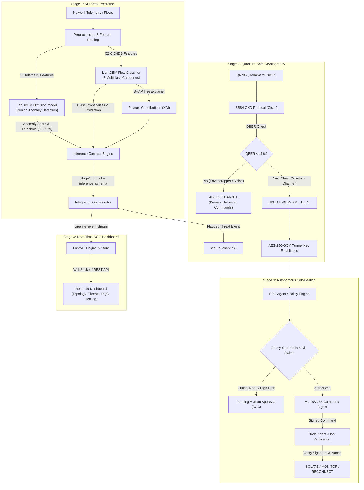

<p align="center">
  
</p>

<h3 align="center">Autonomous post-quantum cybersecurity and self-healing network defense</h3>

<p align="center">
  Detect threats with AI. Secure the response with quantum-safe cryptography. Heal the network automatically.
</p>

<p align="center">
  <a href="https://www.python.org/"></a>
  <a href="https://pytorch.org/"></a>
  <a href="https://lightgbm.readthedocs.io/"></a>
  <a href="https://qiskit.org/"></a>
  <a href="https://fastapi.tiangolo.com/"></a>
  <a href="https://react.dev/"></a>
</p>

<p align="center">
  <a href="https://csrc.nist.gov/pqc"></a>
  <a href="#testing"></a>
  <a href="LICENSE"></a>
</p>

<p align="center">
  <a href="#overview">Overview</a> ·
  <a href="#architecture">Architecture</a> ·
  <a href="#quickstart">Quickstart</a> ·
  <a href="#live-attack-demo">Demo</a> ·
  <a href="#stages-in-detail">Stages</a> ·
  <a href="#contracts">Contracts</a> ·
  <a href="#testing">Testing</a> ·
  <a href="#repository-structure">Structure</a>
</p>

---

## Overview

QuantumShield AI is an enterprise-grade platform that protects critical infrastructure from today's multi-vector network intrusions and tomorrow's quantum adversaries, including *Harvest Now, Decrypt Later* attacks. Four stages form one closed, autonomous defense loop:

```
Telemetry  ──▶  PREDICT  ──▶  PROTECT  ──▶  SELF-HEAL  ──▶  OBSERVE
               AI threat      Quantum-safe    PPO agent       SOC command
               engine         cryptography    remediation     center
```

| Stage | Role | Technology | What it does |
|:--|:--|:--|:--|
| **1 · Predict** | Detect | TabDDPM · LightGBM · SHAP | Dual-engine AI: benign-distribution anomaly detection plus supervised classification of 7 traffic types, with explanations |
| **2 · Protect** | Secure | BB84 · QRNG · ML-KEM-768 · ML-DSA-65 · AES-256-GCM | QKD with QBER monitoring, quantum entropy, NIST post-quantum key exchange and signatures, hybrid secure tunnel |
| **3 · Self-Heal** | Respond | PPO reinforcement learning | Proportional actions under multi-tier guardrails, human approval for critical assets, cryptographically verified node commands |
| **4 · Observe** | Command | FastAPI · React 19 · WebSockets | Live topology, threat analytics, quantum channel metrics, and interactive attack simulation |

---

## Architecture



---

## Quickstart

**Requires:** Python 3.10, 3.11, or 3.12 · Node.js 20+ (or [Bun](https://bun.sh/) 1.1+) · macOS, Linux, or Windows (WSL recommended)

```bash
# 1. Install
git clone https://github.com/your-org/quantumshield-ai.git
cd quantumshield-ai
python3 -m venv venv
source venv/bin/activate            # Windows: .\venv\Scripts\Activate.ps1
pip install -r requirements-integration.txt

# 2. Train models (~2 min on a standard CPU, synthetic data)
python -m stage1.train --data synthetic    # TabDDPM + LightGBM, writes models/ and artifacts/
python -m stage3.train                     # PPO self-healing policy

# 3. Start the backend API and engine
cd backend_dashboard
uvicorn app.main:app --host 0.0.0.0 --port 8000 --reload

# 4. Start the SOC dashboard (new terminal)
cd frontend
cp .env.example .env                # set VITE_USE_MOCK_DATA=false to use the live backend
npm install && npm run dev
```

| Service | URL |
|:--|:--|
| SOC Dashboard | http://localhost:8080 (or the port shown in your terminal) |
| Built-in backend dashboard | http://localhost:8000 |
| Interactive API docs (OpenAPI) | http://localhost:8000/docs |
| Live WebSocket endpoint | `ws://localhost:8000/ws` |

---

## Live Attack Demo

Open **Simulation Center** (`/simulation`) and launch DDoS, DoS, Brute Force, Port Scan, or an Eve eavesdropping attack. Or run the CLI harness:

```bash
PYTHONPATH=stage1_ai_threat_prediction python -m stage1.demo
```

| Step | What happens |
|:--:|:--|
| **1. Detect** | LightGBM flags the flow with high confidence, TabDDPM scores it above `0.56279`, SHAP isolates the top contributing features |
| **2. Secure** | Stage 2 starts `secure_channel()` and exchanges QRNG-derived photons across BB84 bases. An eavesdropper pushes QBER to ~25% and the channel shuts down immediately |
| **3. Respond** | On a verified channel, the PPO policy issues an `isolate` action signed with ML-DSA-65 |
| **4. Actuate** | The target host validates the signature, nonce, and expiry, then isolates itself from the VLAN |
| **5. Recover** | When the threat clears, the host transitions to `reconnect`, rekeys with a fresh PQC session key, and returns to service |

---

## Stages in Detail

### Stage 1 · AI Threat Prediction

Two engines run in parallel: one catches the unknown, the other names the known. Anomaly scores and classification probabilities are kept as distinct risk dimensions under an explicit model registry policy.

**TabDDPM anomaly detection** ([`tabddpm.py`](stage1_ai_threat_prediction/stage1/tabddpm.py))

- A PyTorch Denoising Diffusion Probabilistic Model trained on benign network distribution. Deviations produce elevated reverse-diffusion reconstruction error.
- **Decision threshold:** `0.56279456615448` (`score_timesteps=8`, seed `142`).
- **Zero-day detection:** traffic that signature models leave unclassified but that crosses the threshold is flagged `ANOMALY_UNKNOWN`.

<details>
<summary>11 input telemetry features</summary>

<br>

`e2c_total_bytes` · `e4_entropy_h` · `e5_entropy_c` · `e6_time_char` · `e6b_flow_duration_ms` · `e2_client_size` · `e2_client_record_len` · `e2_server_record_len` · `e1_alg_suite_mlkem1024` · `e1_alg_suite_mlkem768` · `e1_alg_suite_x25519`

</details>

**LightGBM multiclass classification** ([`classifier.py`](stage1_ai_threat_prediction/stage1/classifier.py))

- A gradient-boosted tree classifier over 52 standardized CIC-IDS2017 flow metrics: packet lengths, flow duration, inter-arrival times, flag ratios, and TCP window parameters.
- Test **Macro-F1 > 0.93** across all classes.

| ID | 0 | 1 | 2 | 3 | 4 | 5 | 6 |
|:--|:--:|:--:|:--:|:--:|:--:|:--:|:--:|
| **Class** | Normal Traffic | DoS | DDoS | Port Scanning | Brute Force | Web Attacks | Bots |

**Explainable AI** ([`explain.py`](stage1_ai_threat_prediction/stage1/explain.py))

- `shap.TreeExplainer` on raw LightGBM tree margins yields exact per-feature contributions, translated into SOC-readable reasons such as *"spike in SYN flag ratio"* or *"unusual packet rate"*.

<details>
<summary>Sample inference response (<a href="contracts/inference_schema.json"><code>inference_schema.json</code></a>)</summary>

```json
{
  "event_id": "evt_9aed333dd04f",
  "timestamp_utc": "2026-11-18T07:23:42.967285+00:00",
  "tabddpm": {
    "anomaly_score": 0.77554,
    "threshold": 0.56279,
    "is_anomaly": true
  },
  "lightgbm": {
    "predicted_class": "Brute Force",
    "predicted_class_id": 4,
    "class_probabilities": { "Normal Traffic": 0.157, "Brute Force": 0.841, "...": "..." }
  },
  "explainability": {
    "method": "shap.TreeExplainer",
    "top_contributing_features": [
      { "feature": "PSH Flag Count", "shap_value": 9.959, "impact": "positive", "phrase": "spike in PSH flag count" }
    ]
  },
  "risk_assessment": { "risk_level": "critical", "policy_version": "1.0" },
  "response": { "recommended_action": "isolate", "execution_status": "pending_approval" }
}
```

</details>

---

### Stage 2 · Quantum-Safe Cryptography

Remediation channels and control commands cannot be intercepted, decrypted, forged, or replayed, even by an adversary with a cryptographically relevant quantum computer.

**QRNG** ([`qrng.py`](stage2_quantum_cryptography/stage2/qrng.py))

A Qiskit circuit applies Hadamard gates to initialized qubits, and measurement extracts genuine quantum entropy that seeds the post-quantum algorithms:

$$\lvert 0 \rangle \xrightarrow{H} \frac{\lvert 0 \rangle + \lvert 1 \rangle}{\sqrt{2}}$$

**BB84 quantum key distribution** ([`bb84.py`](stage2_quantum_cryptography/stage2/bb84.py))

- Simulates polarized photon exchange across Rectilinear ($+$) and Diagonal ($\times$) bases, sifts the bases, and computes the **Quantum Bit Error Rate (QBER)**.
- **Threshold policy:** at $\text{QBER} \ge 11\%$, eavesdropping or severe channel disturbance is detected. The pipeline aborts immediately and refuses to issue commands over an untrusted channel.

**NIST post-quantum cryptography** ([`pqc.py`](stage2_quantum_cryptography/stage2/pqc.py))

| Primitive | Standard | Role |
|:--|:--|:--|
| **ML-KEM-768** (Kyber) | FIPS 203 | Key encapsulation, combined with BB84 sifted entropy via HKDF-SHA256 to derive AES-256-GCM session keys |
| **ML-DSA-65** (Dilithium) | FIPS 204 | Digital signatures that make remediation commands unforgeable |

**Command authentication and replay defense** ([`commands.py`](stage2_quantum_cryptography/stage2/commands.py))

- Commands carry monotonic nonces, expiration timestamps, target node IDs, and permitted action allowlists, signed with the orchestrator's private ML-DSA key.

---

### Stage 3 · Autonomous Self-Healing

Threat detections become safe, proportional network actions without causing self-inflicted denial of service.

**PPO reinforcement learning agent** ([`ppo.py`](stage3_self_healing/stage3/ppo.py))

- Custom actor-critic network with Generalized Advantage Estimation (GAE) and action masking.

| Action | Effect |
|:--|:--|
| `isolate` | Quarantine the host |
| `monitor` | Deep packet inspection |
| `reconnect` | Restore the host after remediation and rekeying |

**Multi-tier safety guardrails** ([`guardrails.py`](stage3_self_healing/stage3/guardrails.py))

| Guardrail | Effect |
|:--|:--|
| Action allowlist | Only strictly defined transitions execute |
| Quarantine ceiling | Never isolates more than a maximum fraction (e.g. 50%) of the fleet at once |
| Critical-asset protection | Flagged nodes such as domain controllers and database clusters switch to `pending_human_approval` |
| Kill switch + rate limiting | Global emergency freeze prevents cascading loops |

**Node-side verification** ([`node_agent.py`](stage3_self_healing/stage3/node_agent.py))

- A host daemon verifies the ML-DSA signature against the orchestrator's public key before altering iptables or VLAN rules. Forged, replayed, or expired commands are discarded.

---

### Stage 4 · SOC Command Center

**Backend** ([`backend_dashboard/app/`](backend_dashboard/app/))

- **FastAPI** application wrapping the integration orchestrator.
- Persistent **SQLite** event log and auditing store.
- Bi-directional **WebSocket** broadcast at `/ws` with sub-second updates.
- Full REST API with OpenAPI documentation at `/docs`.

**Frontend** ([`frontend/src/`](frontend/src/)) built with React 19, TanStack Start, Tailwind CSS, Framer Motion, and Recharts.

| Route | View |
|:--|:--|
| `/` | Overview: real-time threat counters and health gauges |
| `/threats` | AI threat prediction feed with SHAP feature breakdowns |
| `/cryptography` | QKD metrics: QBER, sifting, PQC handshake times |
| `/self-healing` | Fleet status, active quarantines, pending human approvals |
| `/topology` | Interactive network map with node infection statuses |
| `/pipeline` | Full end-to-end execution trace for every security event |
| `/simulation` | Attack injection console: DDoS, DoS, PortScan, BruteForce, Eavesdropping |
| `/settings` | Guardrail thresholds, PQC parameters, API configuration |

---

## Contracts

Stages communicate only through JSON Schemas in [`contracts/`](contracts/), so each one can be developed, tested, and replaced independently.

| Contract | Producer → Consumer | Schema |
|:--|:--|:--|
| `stage1_output` | Stage 1 → Stage 2, Stage 3, Orchestrator | [`stage1_output.schema.json`](contracts/stage1_output.schema.json) |
| `inference_schema` | Stage 1 → SOC, SIEM, Metrics | [`inference_schema.json`](contracts/inference_schema.json) |
| `stage2_output` | Stage 2 → Stage 3, Orchestrator | [`stage2_output.schema.json`](contracts/stage2_output.schema.json) |
| `stage3_command` | Stage 3 → Fleet Nodes, Orchestrator | [`stage3_command.schema.json`](contracts/stage3_command.schema.json) |
| `pipeline_event` | Orchestrator → Stage 4 Backend & Dashboard | [`pipeline_event.schema.json`](contracts/pipeline_event.schema.json) |

---

## Testing

**82 automated tests** cover all subsystems, with contract compliance and numerical stability verified.

```bash
bash scripts/run_all_tests.sh
```

| Suite | Command | Tests | Scope |
|:--|:--|:--:|:--|
| **Stage 1** | `cd stage1_ai_threat_prediction && pytest` | 12 | TabDDPM, LightGBM, SHAP, contracts |
| **Stage 2** | `cd stage2_quantum_cryptography && pytest` | 25 | QRNG, BB84, ML-KEM, ML-DSA, channel |
| **Stage 3** | `cd stage3_self_healing && pytest` | 10 | PPO, guardrails, policy, node agent |
| **Stage 4** | `cd backend_dashboard && pytest` | 24 | FastAPI endpoints, WebSocket, store |
| **Integration** | `pytest integration/tests/` | 11 | End-to-end pipeline and lifecycle |
| **Total** | | **82** | **Zero failures** |

---

## Scientific Principles

1. **Anomaly scores are not probabilities.** The TabDDPM score is a sample's reconstruction distance from the learned manifold of benign telemetry, calibrated against a threshold rather than an empirical probability.
2. **Classification confidence is not operational risk.** High classifier confidence alone never dictates destructive isolation. Risk scoring factors in host criticality, anomaly severity, and connection context.
3. **SHAP attributions are not causal proof.** SHAP values quantify feature contributions to the model's raw output margin, giving operational interpretability rather than deterministic causality.
4. **Never act over an untrusted channel.** If key agreement detects eavesdropping ($\text{QBER} \ge 11\%$) or a signature is invalid, the orchestrator refuses to emit remediation commands, preventing adversarial takeover.

---

## Repository Structure

<details>
<summary>Expand full directory tree</summary>

```
quantumshield-ai/
├── contracts/                        # JSON Schemas governing inter-stage data contracts
│   ├── inference_schema.json         # TabDDPM & LightGBM unified inference contract
│   ├── stage1_output.schema.json     # Threat label, confidence, risk score, explanations
│   ├── stage2_output.schema.json     # BB84 QBER, ML-KEM key IDs, handshake latencies
│   ├── stage3_command.schema.json    # ML-DSA signed commands, nonces, actions
│   └── pipeline_event.schema.json    # End-to-end event broadcast to dashboard
│
├── models/                           # Registered model manifests and binary artifacts
│   ├── quantumshield_model_registry.json
│   ├── tabddpm/improved/             # TabDDPM checkpoint (.pt) + preprocessor (.joblib)
│   └── cicids_classifier/            # LightGBM model (.txt) + bundle (.joblib)
│
├── stage1_ai_threat_prediction/      # STAGE 1: AI Threat Prediction
│   ├── stage1/
│   │   ├── tabddpm.py                # TabDDPM PyTorch diffusion anomaly detector
│   │   ├── classifier.py             # LightGBM 52-feature multiclass classifier
│   │   ├── explain.py                # SHAP TreeExplainer feature attribution
│   │   ├── predictor.py              # ThreatPredictor coordinating inference contracts
│   │   ├── preprocess.py             # Feature cleaning & scaling pipelines
│   │   ├── data.py                   # CIC-IDS2017 & synthetic flow data generators
│   │   └── train.py                  # End-to-end model training entrypoint
│   └── tests/                        # 12 automated unit tests
│
├── stage2_quantum_cryptography/      # STAGE 2: Quantum-Safe Cryptography
│   ├── stage2/
│   │   ├── qrng.py                   # Quantum Random Number Generator (Qiskit circuit)
│   │   ├── bb84.py                   # BB84 QKD protocol & QBER eavesdropper detection
│   │   ├── pqc.py                    # NIST FIPS 203 ML-KEM & FIPS 204 ML-DSA
│   │   ├── channel.py                # Hybrid HKDF & AES-256-GCM authenticated cipher
│   │   ├── commands.py               # Cryptographic command signing & verification
│   │   └── pipeline.py               # secure_channel() pipeline orchestrator
│   └── tests/                        # 25 automated unit tests
│
├── stage3_self_healing/              # STAGE 3: Autonomous Self-Healing
│   ├── stage3/
│   │   ├── ppo.py                    # Custom Actor-Critic PPO reinforcement learning
│   │   ├── env.py                    # Network infection simulation environment
│   │   ├── guardrails.py             # Rate limiters, kill switch & human approval
│   │   ├── policy.py                 # Live orchestrator policy adapter
│   │   └── node_agent.py             # Host agent verifying ML-DSA signatures
│   └── tests/                        # 10 automated unit tests
│
├── backend_dashboard/                # STAGE 4: Backend API & WebSocket Server
│   ├── app/
│   │   ├── main.py                   # FastAPI REST routes & WebSocket endpoint
│   │   ├── engine.py                 # Simulation engine, pipeline dispatcher
│   │   ├── adapter.py                # Format transformer for frontend components
│   │   ├── store.py                  # SQLite event persistence
│   │   └── simulator.py              # Synthetic background traffic injection
│   └── tests/                        # 24 automated unit tests
│
├── frontend/                         # STAGE 4: React 19 SOC Dashboard
│   ├── src/
│   │   ├── routes/                   # TanStack Start file-based pages (8 views)
│   │   ├── components/               # UI components, meters, topology canvas
│   │   └── services/                 # WebSocket client & API fetchers
│   └── package.json
│
├── integration/                      # End-to-End Integration Orchestrator
│   ├── orchestrator.py               # Coordinates Stages 1 -> 2 -> 3 -> 4
│   └── tests/                        # 11 automated integration tests
│
├── docs/                             # Engineering runbooks, architecture guides
├── scripts/                          # Test runners and deployment helpers
└── requirements-integration.txt      # Root Python dependencies for all stages
```

</details>

---

<p align="center">
<a href="LICENSE"></a>
</p>
